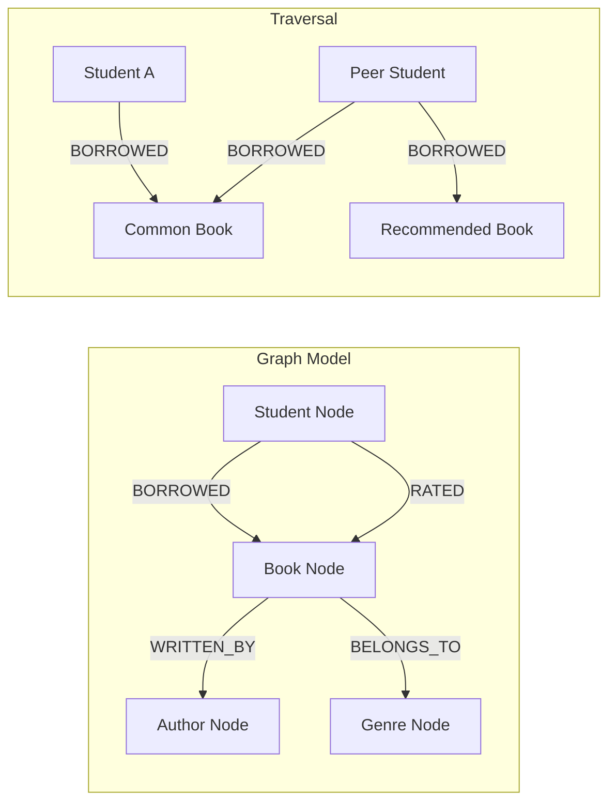

# BookGraph System Architecture & Graph Modeling

BookGraph is a graph-native library recommendation and circulation analytics platform powered by the **Neo4j** graph database.



---

## 1. Graph Data Model (Labeled Property Graph)

### Nodes
- **`Student`**: Represents library members.
  - Properties: `usn` (Unique Key), `name`, `branch`, `sem`, `email`
- **`Book`**: Represents cataloged literature and textbooks.
  - Properties: `id` (Unique Key), `title`, `year`, `isbn`, `pages`
- **`Author`**: Represents creators.
  - Properties: `id` (Unique Key), `name`, `country`
- **`Genre`**: Represents subject categories.
  - Properties: `id` (Unique Key), `name`, `shelf`

### Directed Relationships
- `(Student)-[:BORROWED {borrow_date, return_date, status}]->(Book)`
- `(Student)-[:RATED {stars, review}]->(Book)`
- `(Book)-[:WRITTEN_BY]->(Author)`
- `(Book)-[:BELONGS_TO]->(Genre)`

---

## 2. Core Advantages of Property Graph Over Relational Storage

1. **Index-Free Adjacency:** In an RDBMS, joining users to items and peers requires index scans costing $O(\log N)$ per join. In Neo4j, relationships are stored as direct physical memory pointers, resulting in $O(1)$ constant time per relationship hop regardless of total database size.
2. **First-Class Relationships:** Relationships carry properties (`borrow_date`, `status`, `stars`) without requiring separate junction or associative tables.
3. **Declarative Pattern Matching:** Cypher allows developers to describe the visual path to traverse instead of writing nested SQL Cartesian products.

---

## 3. Recommendation Algorithms

### 3.1 Collaborative Filtering (Peer Traversal)
Identifies reader communities with overlapping checkouts and discovers unread books borrowed by those peers:
```cypher
MATCH (me:Student {usn: $usn})-[:BORROWED]->(shared:Book)<-[:BORROWED]-(peer:Student)
WHERE me <> peer
MATCH (peer)-[:BORROWED]->(rec:Book)
WHERE NOT (me)-[:BORROWED]->(rec)
OPTIONAL MATCH (rec)-[:WRITTEN_BY]->(a:Author)
OPTIONAL MATCH (rec)-[:BELONGS_TO]->(g:Genre)
RETURN rec.id AS BookID,
       rec.title AS Title,
       collect(DISTINCT a.name) AS Authors,
       g.name AS Genre,
       count(DISTINCT peer) AS PeerScore
ORDER BY PeerScore DESC
LIMIT 5;
```

### 3.2 Content-Based Affinity
Scores the student's historical interest across genres and surfaces top-rated unread titles:
```cypher
MATCH (me:Student {usn: $usn})-[:BORROWED]->(:Book)-[:BELONGS_TO]->(g:Genre)
WITH me, g, count(*) AS genreScore
ORDER BY genreScore DESC
LIMIT 2
MATCH (rec:Book)-[:BELONGS_TO]->(g)
WHERE NOT (me)-[:BORROWED]->(rec)
OPTIONAL MATCH (rec)-[:WRITTEN_BY]->(a:Author)
RETURN rec.id AS BookID, rec.title AS Title, g.name AS Genre, genreScore
ORDER BY genreScore DESC, rec.year DESC
LIMIT 5;
```

### 3.3 Degrees of Reading (Shortest Path)
Employs Breadth-First-Search (BFS) via `shortestPath()` to uncover the shortest chain connecting two readers:
```cypher
MATCH p = shortestPath((s1:Student {usn: $s1})-[:BORROWED*]-(s2:Student {usn: $s2}))
RETURN [node IN nodes(p) | coalesce(node.title, node.name)] AS PathSequence,
       length(p) AS DegreeDistance;
```
