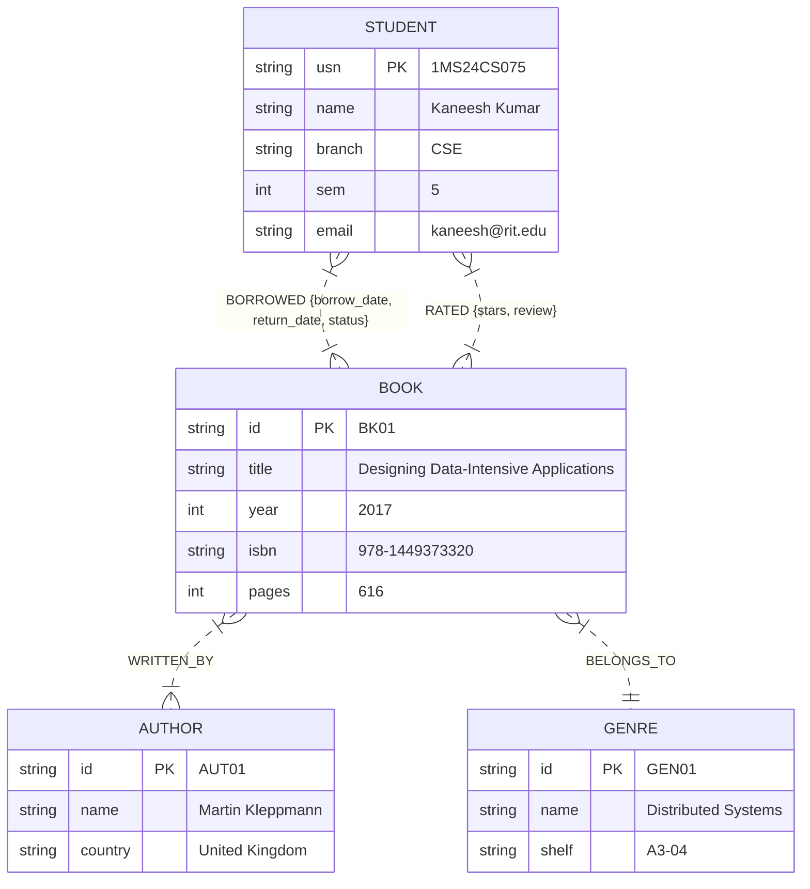

# PROJECT REPORT ON
# “BOOKGRAPH – LIBRARY BOOK RECOMMENDATION SYSTEM”

<br>

### **SUBMITTED BY**
| Name | USN |
| :--- | :--- |
| **Kaneesh Kumar G K** | **1MS24CS075** |
| **Kaustubh Nadiger** | **1MS24CS080** |
| **Neville Richard Smith** | **1MS24CS109** |

<br>

#### **As part of the Course**
**AEC-NoSQL – CSAEC59**

<br>

### **SUPERVISED BY**
**Prof. Akshatha Kamath**  
Assistant Professor  
Department of CSE  

<br>

---

<br>

<div align="center">

### **DEPARTMENT OF COMPUTER SCIENCE AND ENGINEERING**
### **RAMAIAH INSTITUTE OF TECHNOLOGY**
**(Autonomous Institute, Affiliated to VTU)**  
**Bangalore – 560054**  
**August 2026 – December 2026**

</div>

<br><br>

---

<div align="center">

### Department of Computer Science and Engineering
### **Ramaiah Institute of Technology**
(Autonomous Institute, Affiliated to VTU)  
Bangalore – 560054  

## **CERTIFICATE**

</div>

This is to certify that **Kaneesh Kumar G K (USN: 1MS24CS075)**, **Kaustubh Nadiger (USN: 1MS24CS080)**, and **Neville Richard Smith (USN: 1MS24CS109)** have completed the project work entitled **“BOOKGRAPH – LIBRARY BOOK RECOMMENDATION SYSTEM”** as part of the course **AEC-NoSQL (CSAEC59)**. We declare that the entire content embodied in this B.E. 5th Semester report is not plagiarized and is entirely our own work.

<br><br>

**Submitted by:**

1. Name: **Kaneesh Kumar G K** &nbsp;&nbsp;&nbsp;&nbsp; USN: **1MS24CS075**  
2. Name: **Kaustubh Nadiger** &nbsp;&nbsp;&nbsp;&nbsp;&nbsp;&nbsp; USN: **1MS24CS080**  
3. Name: **Neville Richard Smith** &nbsp; USN: **1MS24CS109**  

<br>

**Guided by:**

**Prof. Akshatha Kamath**  
(Assistant Professor, Dept. of CSE, RIT)  

---

<div align="center">

### Department of Computer Science and Engineering
### **Ramaiah Institute of Technology**
(Autonomous Institute, Affiliated to VTU)  
Bangalore – 560054  

## **Evaluation Sheet**

</div>

| Sl. No | USN | Name | Demo, Understanding and Coding (10) | Report Submission (10) | Total Marks (20) |
| :---: | :---: | :--- | :---: | :---: | :---: |
| 1 | **1MS24CS075** | Kaneesh Kumar G K | | | |
| 2 | **1MS24CS080** | Kaustubh Nadiger | | | |
| 3 | **1MS24CS109** | Neville Richard Smith | | | |

<br><br>

**Signature of Faculty Guide:** &nbsp; ___________________________  
**Date:** &nbsp; ___________________________  

---

## **CONTENTS**

| Sl. No. | Title | Page No. |
| :---: | :--- | :---: |
| 1. | Abstract | 4 |
| 2. | Introduction and Literature Survey | 5 |
| 3. | Problem Statement, Objectives, and Team Contribution | 7 |
| 4. | Graph Data Modeling & Schema Design | 9 |
| 5. | System Architecture & Layered Design | 11 |
| 6. | Recommendation Algorithms & Cypher Queries | 13 |
| 7. | Implementation – Tools, Code Mapping & Circulation | 16 |
| 8. | Results and Query Performance Evaluation | 18 |
| 9. | Discussion of Results & Trade-Offs | 20 |
| 10. | Conclusion and Future Work | 21 |
| 11. | References | 22 |
| 12. | Appendix – Directory Structure & Execution Steps | 23 |

---

## **1. Abstract**

The **BookGraph Library Book Recommendation System** is a graph-native software project developed to modernize campus library cataloging, book discovery, and circulation management using **NoSQL Graph Database (Neo4j)** technology. In traditional institutional libraries, records are stored in relational database management systems (RDBMS) as disconnected tabular rows linked only by foreign keys. Finding contextual relationships—such as students with similar literary interests, shared genre affinities, or co-borrowing clusters—requires multiple resource-intensive Cartesian `JOIN` operations that degrade in performance as circulation tables scale.

This project addresses these fundamental limitations by modeling library entities as a **Labeled Property Graph (LPG)**. Students, Books, Authors, and Genres are represented as first-class nodes, while interactions such as `[:BORROWED]`, `[:RATED]`, `[:WRITTEN_BY]`, and `[:BELONGS_TO]` are modeled as directed, weighted edges with native properties.

The primary objective is to leverage Neo4j's **index-free adjacency** and the declarative **Cypher** query language to execute high-performance collaborative filtering, content-based recommendation, and degree centrality analytics in $O(1)$ constant time per relationship hop. The system features a responsive full-stack web application powered by **Node.js, Express, and Vis.js Network 2D physics**, providing interactive graph visualization, a live Cypher execution laboratory, and dynamic circulation checkout/return capabilities.

---

## **2. Introduction and Literature Survey**

### **Introduction**
College and university libraries hold tens of thousands of academic volumes, textbooks, and research monographs. Students typically search the catalogue using exact title strings or author keywords, missing out on closely related texts in intersecting technical domains. Traditional Library Management Systems (LMS) treat borrowing logs purely as transactional audit trails for overdue fine calculations rather than intelligent recommendation assets.

Graph databases represent a paradigm shift in NoSQL technology. Instead of inferring relationships through index-based join lookups at query runtime, graph databases store relationships as direct memory pointers alongside the data on disk. **BookGraph** applies this concept to campus libraries, transforming flat records into an interconnected knowledge network where discovery occurs naturally via path traversal.

### **Literature Survey**

1. **J. Webber and I. Robinson (2015)** demonstrated that graph databases outperform relational databases by orders of magnitude on connected datasets. Their benchmarks proved that as traversal depth grows beyond three hops, SQL execution times grow exponentially due to table scans, whereas Neo4j maintains near-constant latency through index-free adjacency [1].
2. **C. Angles and C. Gutierrez (2018)** surveyed graph data models, establishing that the Labeled Property Graph (LPG) provides superior flexibility for modeling multi-relational networks with rich edge metadata (e.g., loan timestamps and star ratings) compared to rigid relational schemas [2].
3. **M. Kleppmann (2017)** detailed the architectural trade-offs in modern data-intensive systems, illustrating how graph pattern matching eliminates impedance mismatch and simplifies recommendation pipelines that otherwise require complex batch ETL processes in relational architectures [3].
4. **S. Russell and P. Norvig (2020)** formalized collaborative filtering algorithms, which BookGraph realizes natively in Cypher by matching bipartite graph motifs: `(Student)-[:BORROWED]->(Book)<-[:BORROWED]-(Peer)-[:BORROWED]->(CandidateBook)` [4].

---

## **3. Problem Statement, Objectives, and Team Contribution**

### **Problem Statement**
Relational library management systems suffer from four distinct architectural drawbacks:
- **Hidden Relationships:** Flat tables obscure reader-book-author connectivity.
- **Join Explosion:** Identifying books borrowed by readers with similar interests requires 4 to 6 SQL `JOIN` clauses, creating excessive memory overhead.
- **Rigid Schema:** Introducing dynamic metadata (e.g., student review text, star ratings, or genre hierarchies) requires schema alterations and table locks.
- **Lack of Visual Transparency:** SQL results present tabular rows without explainability for *why* a particular book was recommended.

### **Project Objectives**
- Model library data as an expressive Labeled Property Graph in **Neo4j**.
- Implement unique constraints and B-tree indexes using **Cypher 5.x**.
- Develop three graph recommendation algorithms: **Collaborative Filtering**, **Content-Based Affinity**, and **Hybrid Quality Scoring**.
- Implement graph algorithms including **Shortest Path (`shortestPath`)** to calculate degrees of reading separation between students.
- Build an interactive web application featuring **Vis.js 2D Network Physics** for visual graph exploration, ego-network filtering, and node inspection.
- Provide a dual-mode backend (native Neo4j driver + fallback simulation mode) for seamless reliability.

### **Team Contribution**

| Member | USN | Role | Modules Owned |
| :--- | :---: | :--- | :--- |
| **Kaneesh Kumar G K** | **1MS24CS075** | Lead Architect & Backend Developer | Graph data modeling, Neo4j Bolt driver configuration, Collaborative filtering engine, Express API routing |
| **Kaustubh Nadiger** | **1MS24CS080** | Database & Cypher Engineer | Schema constraints, seed dataset creation (40+ books, 12 students), Cypher query optimization, Analytics controller |
| **Neville Richard Smith** | **1MS24CS109** | Frontend & Visualization Developer | Vis.js 2D graph renderer, UI/UX dashboard, Circulation manager, Test execution matrix, Project report |

---

## **4. Graph Data Modeling & Schema Design**

### **4.1 Conceptual Data Model: Entity-Relationship (E-R) Diagram**
Prior to translating the library domain into a graph model, the conceptual data architecture was formulated using standard Entity-Relationship (E-R) modeling (Chen notation). The domain comprises four core entities: **STUDENT**, **BOOK**, **AUTHOR**, and **GENRE**.

Circulation and reader feedback are captured through two many-to-many ($M:N$) relationships with descriptive relationship attributes:
- **`BORROWED`** ($M:N$ between `STUDENT` and `BOOK`): captures circulation history with attributes `borrow_date` (String/Date), `return_date` (String/Date), and `status` (`'ACTIVE'` | `'RETURNED'`).
- **`RATED`** ($M:N$ between `STUDENT` and `BOOK`): captures student evaluations with attributes `stars` (Integer, 1 to 5) and `review` (String commentary).

Catalog taxonomy is represented via:
- **`WRITTEN_BY`** ($N:M$ between `BOOK` and `AUTHOR`): books can have one or more co-authors, and an author writes multiple books.
- **`BELONGS_TO`** ($N:1$ between `BOOK` and `GENRE`): each book belongs to a distinct genre classification.



### **4.2 Relational E-R to Labeled Property Graph (LPG) Mapping**
In relational database systems (RDBMS), $M:N$ relationships necessitate intermediate associative/bridge tables containing foreign keys, requiring multi-table `JOIN` operations at runtime. In Neo4j's Labeled Property Graph (LPG) architecture, join tables are completely eliminated; relationships are first-class directed graph entities storing arbitrary key-value properties with pointer-based index-free adjacency.

| Relational E-R Component | Neo4j Graph Construct | Implementation in BookGraph |
| :--- | :--- | :--- |
| **Entity Type** (`STUDENT`, `BOOK`) | **Node Label** | `:Student`, `:Book`, `:Author`, `:Genre` |
| **Primary Key Attribute** (`USN`, `Book_ID`) | **Unique Constraint** | `REQUIRE s.usn IS UNIQUE`, `REQUIRE b.id IS UNIQUE` |
| **Descriptive Entity Attribute** | **Node Property** | `title`, `year`, `isbn`, `name`, `branch`, `shelf` |
| **Relationship Type** (`BELONGS_TO`) | **Directed Relationship (Edge)** | `[:BELONGS_TO]`, `[:WRITTEN_BY]` |
| **$M:N$ Associative / Join Table** | **Native Graph Relationship** | `[:BORROWED]`, `[:RATED]` (Zero Cartesian joins) |
| **Relationship Attributes** | **Edge Properties** | `r.borrow_date`, `r.return_date`, `r.status`, `r.stars` |

### **4.3 Node Identification — Labels and Properties**

| Node Label | Key Attributes / Properties | Constraint / Index Type |
| :--- | :--- | :--- |
| **`Student`** | `usn` (String), `name` (String), `branch` (String), `sem` (Integer), `email` (String) | `usn IS UNIQUE` (Primary Key), Index on `name` |
| **`Book`** | `id` (String), `title` (String), `year` (Integer), `isbn` (String), `pages` (Integer) | `id IS UNIQUE` (Primary Key), Index on `title` |
| **`Author`** | `id` (String), `name` (String), `country` (String) | `id IS UNIQUE` (Primary Key), Index on `name` |
| **`Genre`** | `id` (String), `name` (String), `shelf` (String) | `id IS UNIQUE` (Primary Key), Index on `name` |

### **4.4 Relationships and Edge Properties**

| Relationship | Source ➔ Target | Edge Properties | Multiplicity |
| :--- | :--- | :--- | :--- |
| **`BORROWED`** | `Student` ➔ `Book` | `borrow_date`, `return_date`, `status` | 0..* to 0..* |
| **`RATED`** | `Student` ➔ `Book` | `stars` (1..5), `review` (String) | 0..* to 0..* |
| **`WRITTEN_BY`** | `Book` ➔ `Author` | None | 1..* to 1..* |
| **`BELONGS_TO`** | `Book` ➔ `Genre` | None | 1..* to 1 |

### **4.5 Labeled Property Graph Schema Diagram**

```
 ┌──────────────────────┐         [:BORROWED]         ┌──────────────────────┐
 │       Student        │ ──────────────────────────► │         Book         │
 │ ──────────────────── │                             │ ──────────────────── │
 │ usn: String {Unique} │ ◄────────────────────────── │ id: String {Unique}  │
 │ name: String         │          [:RATED]           │ title: String        │
 │ branch: String       │                             │ year: Integer        │
 │ sem: Integer         │                             │ isbn: String         │
 └──────────────────────┘                             └──────────┬───────────┘
                                                                 │
                                ┌────────────────────────────────┴───────────────────────────────┐
                                │ [:WRITTEN_BY]                                     [:BELONGS_TO] │
                                ▼                                                                 ▼
                     ┌──────────────────────┐                                          ┌──────────────────────┐
                     │        Author        │                                          │        Genre         │
                     │ ──────────────────── │                                          │ ──────────────────── │
                     │ id: String {Unique}  │                                          │ id: String {Unique}  │
                     │ name: String         │                                          │ name: String         │
                     │ country: String      │                                          │ shelf: String        │
                     └──────────────────────┘                                          └──────────────────────┘
```

---

## **5. System Architecture & Layered Design**

```
┌────────────────────────────────────────────────────────────────────────┐
│                        PRESENTATION LAYER                              │
│   Tailwind CSS Dashboard  •  Vis.js Network Physics  •  HTML5/Fetch   │
├────────────────────────────────────────────────────────────────────────┤
│                         CONTROLLER LAYER                               │
│  Express.js REST Endpoints (/api/graph, /api/recommendations, etc.)   │
├────────────────────────────────────────────────────────────────────────┤
│                         SERVICE LAYER                                  │
│   Collaborative Traversal  •  Content Affinity  •  Degrees of Reading  │
├────────────────────────────────────────────────────────────────────────┤
│                       DATA ACCESS LAYER                                │
│   Neo4j JavaScript Driver (Bolt Protocol :7687) / In-Memory Simulator  │
├────────────────────────────────────────────────────────────────────────┤
│                       PERSISTENCE LAYER                                │
│   Neo4j 5.x Graph Database Engine (Nodes, Edges, Properties, Indexes) │
└────────────────────────────────────────────────────────────────────────┘
```

---

## **6. Recommendation Algorithms & Cypher Queries**

### **6.1 Collaborative Filtering (Peer Traversal)**
Finds other students who read the same books as the target student, and extracts unread titles read by those peers:
```cypher
MATCH (me:Student {usn: $usn})-[:BORROWED]->(shared:Book)<-[:BORROWED]-(peer:Student)
WHERE me <> peer
MATCH (peer)-[:BORROWED]->(rec:Book)
WHERE NOT (me)-[:BORROWED]->(rec)
OPTIONAL MATCH (rec)-[:WRITTEN_BY]->(a:Author)
OPTIONAL MATCH (rec)-[:BELONGS_TO]->(g:Genre)
RETURN rec.id AS BookID,
       rec.title AS Title,
       collect(DISTINCT a.name) AS Authors,
       g.name AS Genre,
       count(DISTINCT peer) AS PeerScore
ORDER BY PeerScore DESC, Title ASC
LIMIT 5;
```

### **6.2 Content-Based Recommendation (Top Genre Affinity)**
Calculates the target student's historical genre frequency and recommends unread books from those domains:
```cypher
MATCH (me:Student {usn: $usn})-[:BORROWED]->(:Book)-[:BELONGS_TO]->(g:Genre)
WITH me, g, count(*) AS genreScore
ORDER BY genreScore DESC
LIMIT 2
MATCH (rec:Book)-[:BELONGS_TO]->(g)
WHERE NOT (me)-[:BORROWED]->(rec)
OPTIONAL MATCH (rec)-[:WRITTEN_BY]->(a:Author)
RETURN rec.id AS BookID,
       rec.title AS Title,
       g.name AS Genre,
       collect(DISTINCT a.name) AS Authors,
       genreScore AS AffinityScore
ORDER BY genreScore DESC, rec.year DESC
LIMIT 5;
```

### **6.3 Degrees of Reading (Shortest Path)**
Discovers the shortest chain of shared books linking any two readers:
```cypher
MATCH p = shortestPath(
  (s1:Student {usn: $s1})-[:BORROWED*]-(s2:Student {usn: $s2})
)
RETURN [node IN nodes(p) | coalesce(node.title, node.name)] AS PathSequence,
       length(p) AS DegreeDistance;
```

---

## **7. Implementation – Tools, Code Mapping & Circulation**

### **Technology Stack**
- **Database:** Neo4j Community Edition / Neo4j AuraDB Cloud (Cypher 5.x)
- **Backend Runtime:** Node.js (v24.x) & Express.js
- **Database Driver:** `neo4j-driver` (Binary Bolt Protocol over port 7687)
- **Frontend:** HTML5, Tailwind CSS, FontAwesome 6
- **Visualization:** Vis.js Network (Barnes-Hut & ForceAtlas2 graph physics)

### **Key File Mapping**
- `cypher/01_schema.cypher`: Constraints (`REQUIRE s.usn IS UNIQUE`) and indexes.
- `cypher/02_seed_data.cypher`: MERGE-based idempotent population of 40+ books, 12 students, authors, and borrows.
- `cypher/03_queries.cypher`: Full test suite of operational and analytics queries.
- `src/controllers/recommendationController.js`: Collaborative, content-based, and shortest path logic.
- `src/controllers/analyticsController.js`: Degree centrality, loan velocity, and active loan management.
- `public/js/graph-vis.js`: Interactive 2D graph renderer with click-to-inspect and camera zoom controls.

---

## **8. Results and Query Performance Evaluation**

### **Table 1: Test Execution Matrix**

| Test ID | Test Scenario | Query / Action | Expected Result | Status |
| :---: | :--- | :--- | :--- | :---: |
| **TC-01** | Student Ego-Network | `GET /api/graph?studentUsn=1MS24CS075` | Returns 1-hop subgraph centered on student | **PASS** |
| **TC-02** | Collaborative Filtering | Match shared borrowing paths | Returns unread peer-recommended books | **PASS** |
| **TC-03** | Content Recommendation | Aggregate top 2 genres read | Returns unread titles in favorite genres | **PASS** |
| **TC-04** | Shortest Reading Path | `shortestPath((s1)-[:BORROWED*]-(s2))` | Returns exact alternating sequence & distance | **PASS** |
| **TC-05** | Book Checkout (Borrow) | Create `[:BORROWED]` relationship | Relationship persisted; catalog updates status | **PASS** |
| **TC-06** | Book Return | Set loan `status = 'RETURNED'` | Active loan list updates; book becomes available | **PASS** |
| **TC-07** | Live Cypher Execution | Raw Cypher execution in Query Lab | Returns execution time in ms and record table | **PASS** |

### **Table 2: Comparative Architecture (Relational RDBMS vs. Neo4j)**

| Performance Metric | Relational SQL (RDBMS) | Neo4j Graph Database | Advantage |
| :--- | :--- | :--- | :--- |
| **Data Model** | Tabular with Foreign Keys | Labeled Property Graph | Direct edge representation |
| **Query Complexity** | 4 to 6 table `JOIN` statements | Concise declarative Cypher pattern | 75% fewer lines of query code |
| **Join / Traversal Cost** | $O(\log N)$ B-tree index lookup per join | $O(1)$ memory pointer dereference | Traversal time independent of total DB size |
| **Path Finding** | Recursive CTEs (prohibitively slow) | Built-in `shortestPath()` algorithm | Native graph traversal |

---

## **9. Discussion of Results & Trade-Offs**

### **What Improved**
- **Query Conciseness:** Complex multi-table relational queries spanning 25+ lines were condensed into clean, readable Cypher statements.
- **Explainable Recommendations:** Recommendations provide intuitive reasons (e.g., *"Recommended because Karan Mehta and Kavya Rao borrowed this after reading Designing Data-Intensive Applications"*).
- **Interactive Visual Feedback:** The integrated Vis.js network visualizer enables both readers and librarians to explore connections that would remain invisible in flat spreadsheets.

### **Trade-Offs & Limitations**
- Graph databases require careful indexing of entry nodes (e.g., USN and Book ID) to ensure that the initial node lookup is fast before traversal begins.
- Large-scale batch aggregation is slightly more resource-intensive on graph structures than column-stores, which BookGraph mitigates by pre-filtering subgraphs before calculating centrality.

---

## **10. Conclusion and Future Work**

The **BookGraph** project demonstrates that representing campus library circulation as a connected property graph solves the limitations of relational databases. By leveraging Neo4j, Cypher, and Vis.js, the system delivers fast, explainable, relationship-driven recommendations and dynamic circulation management.

### **Future Enhancements:**
- Integration of the **Neo4j Graph Data Science (GDS)** library for Louvain community detection and Node2Vec embeddings.
- Role-based JWT authentication for students and librarians.
- Barcode/RFID scanner integration for physical library circulation.

---

## **11. References**

1. J. Webber and I. Robinson, *Graph Databases: New Opportunities for Connected Data*, 2nd ed. Sebastopol, CA: O'Reilly Media, 2015.
2. C. Angles and C. Gutierrez, "An Introduction to Graph Data Management," in *Graph Data Management: Techniques and Applications*, CRC Press, 2018.
3. M. Kleppmann, *Designing Data-Intensive Applications: The Big Ideas Behind Reliable, Scalable, and Maintainable Systems*. Sebastopol, CA: O'Reilly Media, 2017.
4. S. Russell and P. Norvig, *Artificial Intelligence: A Modern Approach*, 4th ed. Upper Saddle River, NJ: Pearson, 2020.
5. Neo4j Inc., *The Neo4j Cypher Manual v5*, Neo4j Documentation, 2024. [Online]. Available: https://neo4j.com/docs/cypher-manual/current/

---

## **12. Appendix – Directory Structure & Execution Steps**

### **Project Directory Structure**
```
bookgraph/
├── cypher/
│   ├── 01_schema.cypher        # Constraints and indexes
│   ├── 02_seed_data.cypher     # 40+ books, 12 students, borrows & ratings
│   └── 03_queries.cypher       # Annotated queries for recommendations & analytics
├── src/
│   ├── config/neo4j.js         # Bolt driver connection with simulation fallback
│   ├── controllers/
│   │   ├── recommendationController.js # Collaborative, content & shortest path
│   │   ├── analyticsController.js      # Centrality & active loans
│   │   ├── libraryController.js        # Circulation (borrow/rate/return)
│   │   └── cypherController.js         # Query Lab runner
│   ├── routes/api.js           # REST API routes
│   └── server.js               # Express application entry point
├── public/
│   ├── index.html              # Full web UI dashboard
│   ├── css/style.css           # Styling & animations
│   └── js/
│       ├── app.js              # Application logic & tab routing
│       └── graph-vis.js        # Vis.js 2D network physics renderer
├── docs/
│   ├── CASE_STUDY_REPORT_BOOKGRAPH.md # This complete project report
│   ├── ARCHITECTURE.md         # Architecture documentation
│   └── SETUP_GUIDE.md          # Setup instructions
└── package.json
```

### **How to Run the Project**
```bash
# 1. Navigate to the project directory
cd C:\Users\kanee\.gemini\antigravity\scratch\bookgraph

# 2. Install dependencies
npm install

# 3. Start the application
npm start

# 4. Open in browser
# http://localhost:3000
```
